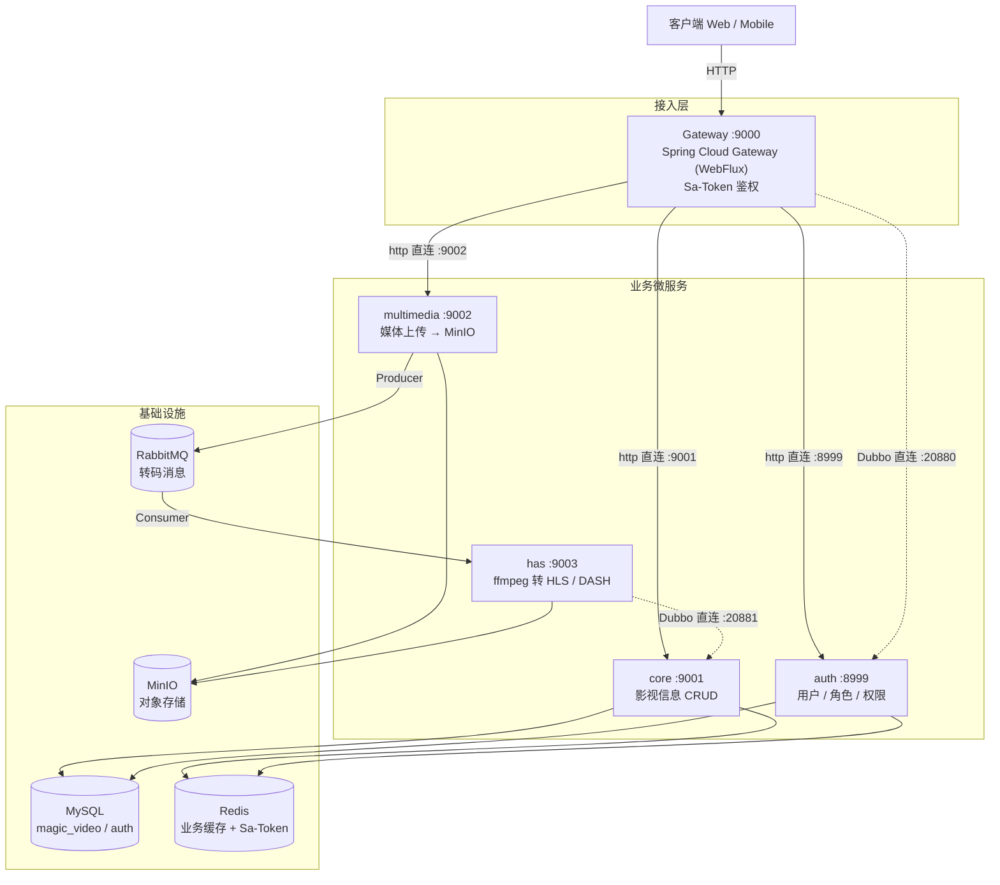
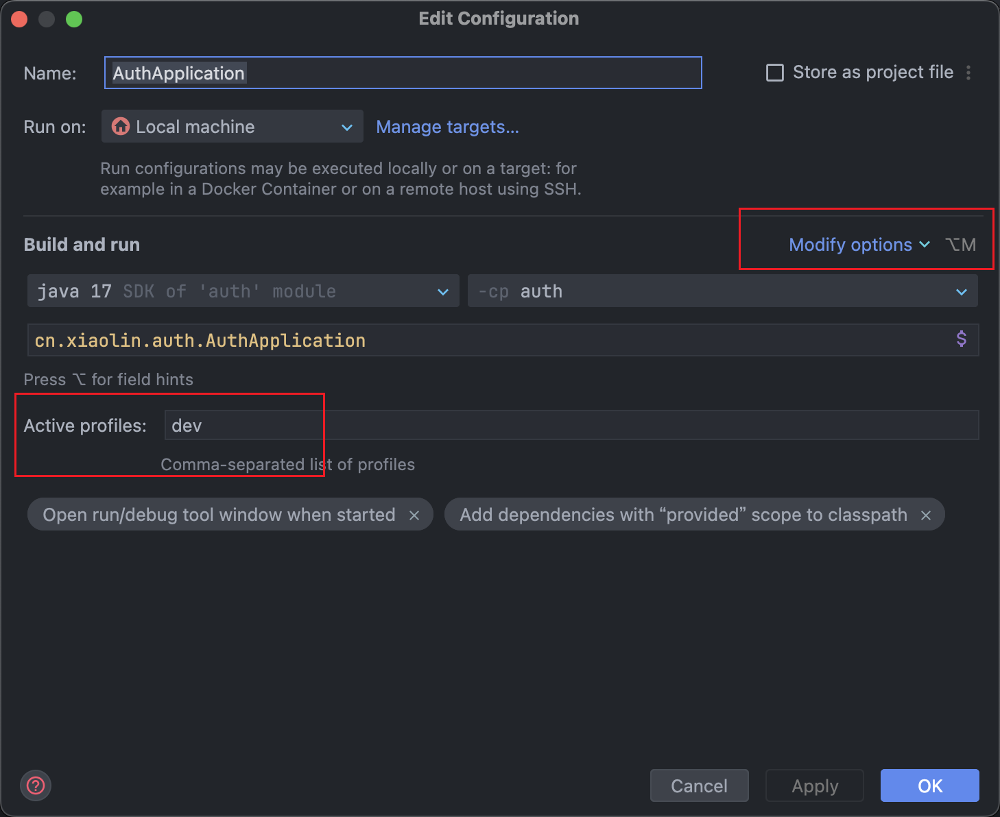

# magic-video-backend

> 基于 Spring Cloud 的**视频点播**微服务后端 —— 影视信息管理 + 媒体上传 + 自适应流转码。

个人项目，目标是完整跑通「微服务拆分 → 鉴权 → 媒体存储 → 异步转码 → 流媒体分发」这条链路，
同时作为 Spring Cloud / DevOps / 可观测性的综合练习场。

---

## 目录

- [技术栈](#技术栈)
- [系统架构](#系统架构)
- [模块结构](#模块结构)
- [快速开始](#快速开始)
- [端口与中间件](#端口与中间件)
- [API 约定](#api-约定)
- [数据模型](#数据模型)
- [配置管理](#配置管理)
- [可观测性](#可观测性)
- [开发指南](#开发指南)
- [文档索引](#文档索引)
- [已知问题](#已知问题)
- [项目现状说明](#项目现状说明)

---

## 技术栈

| 分类 | 组件 | 版本 |
|---|---|---|
| 语言 / 运行时 | Java | 17 |
| 框架 | Spring Boot | 3.3.13 |
| 微服务 | Spring Cloud | 2023.0.5（仅用 Gateway，不含服务发现） |
| 网关 | Spring Cloud Gateway | 4.1.5 |
| RPC | Dubbo | 3.3.4（无注册中心，URL 直连） |
| ORM | MyBatis-Plus | 3.5.7（`mybatis-plus-spring-boot3-starter`） |
| 数据库 | MySQL | 8.4（驱动 8.4.0 / 镜像 8.4.4） |
| 缓存 | Redis（Lettuce 连接池） | 由 Boot BOM 管理 |
| 消息队列 | RabbitMQ | 由 Boot BOM 管理 |
| 对象存储 | MinIO SDK | 8.6.0 |
| 鉴权 | Sa-Token | 1.38.0 |
| 转码 | ffmpeg（apt 安装） | 容器内系统包 |
| 文档 | springdoc-openapi (Swagger UI) | 2.x |
| 可观测性 | Prometheus + Grafana + Loki + Alloy | 见 `volume/` |

> ℹ️ **没有注册中心与配置中心**：本项目为单机单实例部署，Nacos 的收益为零，已彻底移除
> （详见 [ADR-0008](docs/adr/0008-remove-nacos.md)）。网关路由与 Dubbo 调用均使用**显式地址直连**，
> 配置随 jar 走（各服务 `bootstrap-{profile}.yaml`）。

> ⚠️ Boot 目前停在 **3.3.13**：该分支已停止 OSS 漏洞修复，且 `spring-boot-starter-actuator`
> 存在未修复的 CVE-2026-22733。迁移路径见 [`docs/10-architecture-review.md`](docs/10-architecture-review.md) 的「附录 A · 依赖版本升级路线」。

---

## 系统架构



**关键设计点**

- **网关是唯一对外入口**：认证在网关统一拦截，后端服务不各自鉴权。
- **服务间调用全部直连**：没有注册中心。网关用 `http://<host>:<port>`，Dubbo 用 `dubbo://<host>:<port>`，
  地址在各服务 `bootstrap-{profile}.yaml` 中显式给出（见 [ADR-0008](docs/adr/0008-remove-nacos.md)）。
- **同步调用走 Dubbo**：网关每次请求都通过 Dubbo 查用户权限/角色（当前无缓存，见技术债 P2-2）。
- **异步链路走 RabbitMQ**：上传成功后投递转码消息，由 `has` 消费，ffmpeg 编码后经 Dubbo 回调 `core` 落库。
- **`has` 无对外 HTTP 接口**：纯消息消费者 + Dubbo Provider，只在容器内网可达。

更详细的调用矩阵与部署拓扑见 [`docs/02-architecture.md`](docs/02-architecture.md)。

---

## 模块结构

```
magic-video-backend/
├── gateway/          # 网关：路由转发 + Sa-Token 鉴权（WebFlux）
├── auth/             # 鉴权：用户 / 角色 / 权限，提供 Dubbo 权限查询
├── core/             # 核心：影视信息 CRUD，提供 Dubbo 资源读写
├── multimedia/       # 多媒体：图片/视频上传 → MinIO，发送转码消息
├── has/              # 转码：消费 MQ 消息，ffmpeg 编码 HLS / DASH
├── common/           # 公共模块
│   ├── common-api/       # Dubbo 接口契约 + 传输 DTO
│   ├── common-db/        # MyBatis-Plus 配置、审计字段自动填充
│   ├── common-message/   # RabbitMQ 交换机/队列/生产者/消费者
│   └── common-utils/     # Result 包装、异常处理、分页、常量、工具类
├── static/
│   └── mysql/        # 各环境 DDL（dev / local / prod）
├── volume/           # 中间件与可观测性组件的持久化数据/配置
├── docs/             # 设计文档与 ADR（见「文档索引」）
├── docker-compose-dev.yaml    # 中间件（开发：宿主机跑微服务）
├── docker-compose-local.yaml  # 全量容器（本地：一键体验）
├── mini-local.yaml            # 生产编排
└── mini-observability.yaml    # 可观测性编排
```

### 服务职责

| 服务 | 端口 | 职责 | 对外暴露 |
|---|---|---|---|
| `gateway` | 9000 | 统一入口、路由转发、登录校验 | ✅ |
| `auth` | 8999 | 注册/登录/登出、RBAC 权限模型、踢人下线 | ✅（经网关） |
| `core` | 9001 | 影视、合集、季、演员、导演、编剧、制片人、评分等 CRUD | ✅（经网关） |
| `multimedia` | 9002 | 图片/视频上传、分片合并、写入 MinIO | ✅（经网关） |
| `has` | 9003 | 消费转码任务，ffmpeg 编码为 HLS / DASH | ❌（仅内网） |

---

## 快速开始

### 前置要求

- JDK 17+
- Maven 3.8+
- Docker + Docker Compose
- **端口占用检查**：`9000/8999/9001/9002/9003/3306/6379/6389/5672/15672/9010/9011`

---

### 方式一：本地体验（全容器化）

> 适合快速体验，一条命令拉起微服务 + 全部中间件。

**1. 配置环境变量**

仓库根目录已有 `.local.env`。它只需要指定宿主机上的**数据卷路径**与 **DDL 目录**，
服务地址已内置在 `bootstrap-local.yaml`（容器网络内的 `magic-*` 主机名）：

```bash
MYSQL_INIT=/绝对路径/magic-video-backend/static/mysql/local
MULTIMEDIA_MINIO_DATA=/绝对路径/magic-video-backend/volume/minio/multimedia/data
HAS_MINIO_DATA=/绝对路径/magic-video-backend/volume/minio/has/data
```

**2. 启动**

```bash
docker compose -f docker-compose-local.yaml --env-file .local.env up -d
```

**3. 验证**

```bash
curl http://localhost:9000/actuator/health
```

**4. 停止**

```bash
docker compose -f docker-compose-local.yaml --env-file .local.env down
```

> ⚠️ DockerHub 上的镜像仅提供 **amd64** 架构。ARM 机器（如 Apple Silicon）需要本地构建：
>
> ```bash
> mvn clean package -Dmaven.test.skip=true
> docker build -t xxl1997/magic-auth:0.0.1-SNAPSHOT auth/.
> docker build -t xxl1997/magic-gateway:0.0.1-SNAPSHOT gateway/.
> docker build -t xxl1997/magic-core:0.0.1-SNAPSHOT core/.
> docker build -t xxl1997/magic-multimedia:0.0.1-SNAPSHOT multimedia/.
> docker build -t xxl1997/magic-has:0.0.1-SNAPSHOT has/.
> ```

---

### 方式二：开发调试（推荐）

> 适合日常改代码：中间件跑容器，微服务在 IDE 里跑，改完热重启。

**1. 只启动中间件**

```bash
docker compose -f docker-compose-dev.yaml --env-file .dev.env up -d
```

`.dev.env` 中 `MYSQL_INIT` 指向 `static/mysql/dev`，会自动建表并灌入初始数据。

**2. 在 IDE 中启动微服务**

为每个服务设置启动参数 `--spring.profiles.active=dev`：



**3. 按依赖顺序启动**

```
auth  →  gateway  →  core  →  multimedia  →  has
```

- `auth` 必须最先起：网关启动时通过 Dubbo 直连 auth 查权限（`dubbo://localhost:20880`），
  auth 未就绪会导致网关鉴权失败
- `core` 要在 `has` 之前：`has` 转码完成后要通过 Dubbo 直连 core 落库（`dubbo://localhost:20881`）
- `has` 最后起：它只消费 MQ 消息，早起会抢到还没准备好的任务

**4. 停止**

```bash
docker compose -f docker-compose-dev.yaml --env-file .dev.env down
```

---

### 方式三：生产部署

> 生产服务与可观测性服务分离部署。

```bash
# 1. 创建网络（首次）
docker network create magic-backend-network

# 2. 启动业务服务
docker compose -p prod -f mini-local.yaml up -d

# 3. 启动可观测性服务
docker compose -p observability -f mini-observability.yaml up -d
```

停止时按相反顺序：

```bash
docker compose -p observability -f mini-observability.yaml down
docker compose -p prod -f mini-local.yaml down
```

> ⚠️ **生产编排目前只覆盖 `auth` / `gateway` / `core`**。
> `mini-local.yaml` 里**还没有** `multimedia` / `has` / 两个 MinIO，
> 因此 prod 下上传与转码链路不可用（网关的 `magic-multimedia` 路由会 DNS 解析失败）。
> 完整形态见 [`docker-compose-local.yaml`](docker-compose-local.yaml)（含全部 5 个服务 + 2 个 MinIO）。
> 见[技术债 P1-13](docs/09-tech-debt.md)。

---

## 端口与中间件

### 微服务端口（容器内）

| 服务 | HTTP 端口 | Dubbo 端口 | local 对外暴露 | dev 对外暴露 |
|---|---|---|---|---|
| gateway | 9000 | 20882 | ✅ 9000 | ✅ 9000 |
| auth | 8999 | 20880 | ❌ 仅容器内网 | ✅ 8999 |
| core | 9001 | 20881 | ❌ 仅容器内网 | ✅ 9001 |
| multimedia | 9002 | — | ❌ 仅容器内网 | ✅ 9002 |
| has | 9003 | 20883 | ❌ 仅容器内网 | ✅ 9003 |

> Dubbo **协议端口必须固定**（不能用 `-1` 随机端口）：无注册中心直连模式下，
> 消费方需要一个可寻址的固定地址。端口在 `bootstrap-{profile}.yaml` 的 `dubbo.protocol.port` 中声明。

### 中间件端口

| 组件 | 容器端口 | dev 宿主机端口 | local 宿主机端口 | 用途 |
|---|---|---|---|---|
| mysql | 3306 | 3306 | ❌ | `dev_auth` + `dev_magic_video` |
| magic-auth-redis | 6379 | 6379 | ❌ | Sa-Token 分布式会话 |
| magic-redis | 6379 | 6389 | ❌ | 业务缓存 |
| rabbitmq | 5672 / 15672 | 5672 / 15672 | ❌ | 转码消息队列 |
| minio (multimedia) | 9000 / 9001 | 9010 / 9011 | ✅ 9010 / 9011 | 图片/视频对象存储 |
| minio (has) | 9000 / 9001 | 9020 / 9021 | ✅ 9020 / 9021 | 转码产物对象存储 |
| minio (loki) | 9000 / 9001 | 9030 / 9031 | ✅ | Loki 日志存储 |
| grafana | 3000 | 19000 | ✅ 19000 | 监控大盘 |
| prometheus | 9090 | 9090 | ❌ | 指标采集 |
| nginx | 8081 | — | — | 生产统一入口（`mini-local.yaml`） |

> **dev** 模式把中间件端口全部暴露到宿主机，方便 IDEA 直连调试；
> **local** 模式只暴露网关与 MinIO，其余服务只走容器内网；
> **prod** 模式（`mini-local.yaml`）只暴露 Nginx `8081`，作为唯一对外入口。

---

## API 约定

### 路由前缀

**客户端请求路径不带版本前缀**，网关在转发时补上 `/api/v1`：

```
POST /auth/login        → gateway → http://magic-auth:8999/api/v1/auth/login
GET  /core/video/list   → gateway → http://magic-core:9001/api/v1/core/video/list
POST /multimedia/video  → gateway → http://magic-multimedia:9002/api/v1/multimedia/video
```

对应网关配置（`bootstrap-{profile}.yaml`）：

```yaml
- id: auth
  uri: http://magic-auth:8999      # local；dev 为 http://localhost:8999
  filters:
    - PrefixPath=/api/v1           # 网关转发时补版本前缀
  predicates:
    - Path=/auth/**                # 客户端路径，不含 /api/v1
```

> ⚠️ 客户端**不要**自己拼 `/api/v1`：写成 `/api/v1/auth/login` 不会命中 `Path=/auth/**` 路由，
> 会被网关的全局鉴权拦截并返回 `{"code":401,"msg":"当前会话未登陆"}`。

### 统一响应体

所有 HTTP 接口返回 `Result<T>`：

```json
{
  "code": 200,
  "msg": "操作成功",
  "data": { }
}
```

> `msg` 的默认文案是 `操作成功`（见 `common/common-utils/.../enums/ResponseCode.java`），
> **不是** `success`。分页接口的 `data` 为 `PageResult<T>`：

```json
{
  "code": 200,
  "msg": "操作成功",
  "data": {
    "current": 1,
    "size": 20,
    "total": 41,
    "pages": 3,
    "records": [ ]
  }
}
```

### 鉴权

- 登录成功后客户端持有 `sa-token` Cookie（token 名 `sa-token`，有效期 30 天）。
- 网关统一拦截：未登录返回体 `code=401`，无角色/权限返回体 `code=403`。

  > ⚠️ **HTTP 状态码始终是 200**，错误在响应体的 `code` 字段里。
  > 客户端必须判断 `body.code`，不能只判断 `response.status`。实测：
  > `GET /core/video/list` 未登录时返回 HTTP 200 + `{"code":401,"msg":"当前会话未登陆"}`。
- **免登录白名单**（见 `gateway/.../config/SaTokenConfig.java`）：

  ```
  /auth/login  /auth/register
  /swagger-ui/**  /swagger-resources/**  /v3/api-docs/**  /webjars/**  /doc.html
  /actuator/health  /actuator/health/**  /actuator/info
  ```

> `/auth/logout` 与 `/auth/kick-out` **不在**白名单内 —— 它们需要有效会话，且需要校验调用方是否有权强制他人下线。
> 详见 [ADR-0004](docs/adr/0004-sa-token-public-route.md)。

### 主要接口

> 下表路径是**网关转发后到达后端服务**的路径（含 `/api/v1`）。
> 客户端调用时**去掉 `/api/v1` 前缀** —— 例如客户端请求 `POST /auth/login`，
> 网关转发为 `POST /api/v1/auth/login` 给 auth 服务。

<details>
<summary><b>auth</b> —— 认证与 RBAC</summary>

| 方法 | 路径 | 说明 |
|---|---|---|
| POST | `/api/v1/auth/register` | 注册（免登录） |
| POST | `/api/v1/auth/login` | 登录（免登录） |
| POST | `/api/v1/auth/logout` | 登出 |
| POST | `/api/v1/auth/kick-out` | 踢人下线（管理员） |
| GET/POST/PUT/DELETE | `/api/v1/auth/user[/{id}]` | 用户管理 |
| GET | `/api/v1/auth/user/perm/{id}` | 用户权限 |
| GET | `/api/v1/auth/user/role/{id}` | 用户角色 |
| GET | `/api/v1/auth/user/having-perm/{id}` | 拥有某权限的用户 |
| GET | `/api/v1/auth/user/having-role/{id}` | 拥有某角色的用户 |
| GET/POST/PUT/DELETE | `/api/v1/auth/perm[/{id}]` | 权限管理 |
| GET/POST/PUT/DELETE | `/api/v1/auth/role[/{id}]` | 角色管理 |
| GET/POST/PUT/DELETE | `/api/v1/auth/user-perm[/{id}]` | 用户-权限关联 |
| GET/POST/PUT/DELETE | `/api/v1/auth/user-role[/{id}]` | 用户-角色关联 |
| GET/POST/PUT/DELETE | `/api/v1/auth/role-perm[/{id}]` | 角色-权限关联 |

</details>

<details>
<summary><b>core</b> —— 影视信息</summary>

| 方法 | 路径 | 说明 |
|---|---|---|
| GET | `/api/v1/core/video/list` | 分页查询视频（`current`/`size`/`sortBy`/`direction`） |
| GET | `/api/v1/core/video/{id}` | 视频详情（走 Redis 缓存，TTL 10 分钟） |
| GET | `/api/v1/core/video/all` | 全量视频（**已废弃**，见 ADR-0002） |
| GET | `/api/v1/core/video/slide` | 首页轮播 |
| GET | `/api/v1/core/resource/{id}` | 资源详情 |
| GET | `/api/v1/core/resource/all` | 资源分页列表 |
| GET | `/api/v1/core/resource/recommend` `/banner` `/latest` `/classic` `/featured` | 资源推荐位（**当前 5 个端点逻辑完全相同**，见 P1-7） |
| GET/POST/PUT/DELETE | `/api/v1/core/{category,tag,district,award}[/{id}]` | 各维度 CRUD |
| GET/POST/PUT/DELETE | `/api/v1/core/{video-actor,video-director,video-scripter,video-maker,video-category,video-district,video-tag}[/{id}]` | 影视人员/关联关系 CRUD |
| GET | `/api/v1/core/season/list` `/season/{id}` | 季（**只读**） |
| GET | `/api/v1/core/collection/list` `/collection/set` | 合集（**只读**） |

</details>

<details>
<summary><b>multimedia</b> —— 媒体上传</summary>

| 方法 | 路径 | 说明 |
|---|---|---|
| POST | `/api/v1/multimedia/image` | 图片上传（base64 或 MultipartFile） |
| POST | `/api/v1/multimedia/video` | 整文件视频上传 |
| POST | `/api/v1/multimedia/video/chunk` | 分片上传 |
| POST | `/api/v1/multimedia/video/merge` | 分片合并 |
| GET | `/api/v1/multimedia/video/check` | 校验分片是否存在 |

</details>

### 内部 RPC（Dubbo）

| 接口 | 提供方 | 消费者 | 方法 |
|---|---|---|---|
| `UserPermService` | auth | gateway | `getPermByUserId` / `getRoleByUserId` / `getPermWithRolesByUserId` |
| `ResourceService` | core | has | `getResourceById` / `saveResource` |

---

## 数据模型

两个业务库：**auth 库**（权限）与 **magic_video 库**（影视业务），同一 MySQL 实例。

### auth 库

| 表 | 说明 |
|---|---|
| `sys_user` | 用户 |
| `sys_role` | 角色 |
| `sys_permission` | 权限 |
| `sys_user_role` | 用户-角色关联 |
| `sys_user_permission` | 用户-权限关联（直接授权） |
| `sys_role_permission` | 角色-权限关联 |

### magic_video 库

| 表 | 说明 |
|---|---|
| `video` | 影视主表 |
| `video_source` | 资源表（播放源、清晰度、码率） |
| `collection` | 合集 |
| `season` | 季 |
| `category` / `video_category` | 分类及其关联 |
| `district` / `video_district` | 地区及其关联 |
| `tag` / `video_tag` | 标签及其关联 |
| `video_actor` | 演员 |
| `video_director` | 导演 |
| `video_scripter` | 编剧 |
| `video_maker` | 制片人 |
| `award` | 获奖信息 |

DDL 脚本按环境分目录存放：

```
static/mysql/
├── dev/   DDL_auth.sql (6 张)  DDL_video.sql (16 张)
├── local/ DDL_auth.sql (6 张)  DDL_video.sql (4 张)
└── prod/  DDL_auth.sql (6 张)  DDL_video.sql (4 张)
```

> `local` / `prod` 的业务表**缺 12 张**：`category` `video_category` `district` `video_district`
> `tag` `video_tag` `video_actor` `video_director` `video_scripter` `video_maker` `award` `videoResource`。
> 在这些环境上访问相关接口会报表不存在。补齐见[技术债清单](docs/09-tech-debt.md) P1-12。
>
> `prod` 的 `DDL_auth.sql` 是 2026-11-08 随 Nacos 移除一并补建的
> （此前 prod 环境**没有** auth 库脚本）。

### 主键策略

全部 entity 使用 **MyBatis-Plus 内置雪花算法**（`@TableId(type = IdType.ASSIGN_ID)`），
不依赖数据库自增，也不引入外部 ID 协调服务。详见 [ADR-0001](docs/adr/0001-snowflake-id.md)。

---

## 配置管理

### Profile 机制

每个服务有 `bootstrap.yaml` + `bootstrap-{local,dev,prod}.yaml`，通过
`--spring.profiles.active={profile}` 切换。

| profile | 场景 | 依赖地址 | 覆盖的服务 |
|---|---|---|---|
| `local` | 全部容器化 | `magic-mysql` / `magic-redis` / `magic-rabbitmq`（容器主机名） | 全部 5 个 |
| `dev` | 中间件容器 + 微服务宿主机 | `localhost` | 全部 5 个 |
| `prod` | 生产编排 | `magic-mysql` / `magic-redis` / `magic-rabbitmq` | 全部 5 个 |

### 没有配置中心：配置随 jar 走

**本项目没有配置中心，也没有注册中心**。Nacos 已于 2026-11-08 彻底移除
（见 [ADR-0008](docs/adr/0008-remove-nacos.md)）。理由很直接：**单机单实例部署下，
服务发现与配置中心的收益为零，却各多了一个必须常驻的中间件**。

现在地址有两种写法：

**1. Spring Cloud Gateway 路由 → HTTP 直连**

```yaml
# gateway/.../bootstrap-local.yaml
spring:
  cloud:
    gateway:
      routes:
        - id: auth
          uri: http://magic-auth:8999      # dev 下为 http://localhost:8999
          filters:
            - PrefixPath=/api/v1
          predicates:
            - Path=/auth/**
```

**2. Dubbo 调用 → URL 直连**

```yaml
# has/.../bootstrap-local.yaml
dubbo:
  core:
    host: magic-core        # dev 下为 localhost
    port: 20881
```

```java
@DubboReference(url = "dubbo://${dubbo.core.host}:${dubbo.core.port}")
private DubboResourceClient dubboResourceClient;
```

> Dubbo 3.3.4 支持完全不配置注册中心。**协议端口必须固定**（不能用 `-1` 随机端口），
> 否则消费方无法寻址。

### 密钥处理

敏感项已通过环境变量占位符注入，**默认值仅供本地开发**：

```yaml
username: ${MYSQL_USERNAME:root}
password: ${MYSQL_PASSWORD:123456}          # ← 生产必须覆盖
rabbitmq:
  username: ${RABBITMQ_DEFAULT_USER:xiaolin}
  password: ${RABBITMQ_DEFAULT_PASS:123456rabbit}
```

> 生产环境**不要**依赖默认值。同时仓库已开启 `secret_scanning` 与
> `secret_scanning_push_protection`（历史上曾误提交 `.env.local`，目前仅含占位符）。

---

## 可观测性

| 组件 | 作用 | 位置 |
|---|---|---|
| Prometheus | 指标采集（Actuator 暴露） | `volume/prometheus/` |
| Grafana | 监控大盘 | `volume/grafana/` |
| Loki + Promtail | 日志聚合 | `volume/loki/`、`volume/promtail/` |
| Alloy | 采集与转发 | `volume/alloy/` |

各服务的 Actuator 端点已收敛为 `health,info`，并排除了 `cloudfoundry` 与 `gateway`：

```yaml
management:
  endpoints:
    web:
      exposure:
        include: health,info
        exclude: cloudfoundry,gateway
```

---

## 开发指南

### 构建

```bash
# 全量构建（跳过测试）
mvn clean install -DskipTests

# 单模块
mvn -pl core -am clean package
```

### 分页接口规范

列表接口统一使用 `PageQuery` / `PageResult`（`common-utils`，**刻意不依赖 MyBatis-Plus**）：

```java
@GetMapping("/video/list")
public Result<PageResult<VideoVO>> list(PageQuery pageQuery) { ... }
```

| 参数 | 默认值 | 约束 |
|---|---|---|
| `current` | 1 | ≥ 1 |
| `size` | 20 | 1 ~ 200（`PageConsts`） |
| `sortBy` | 创建时间倒序 | 支持 `rating` / `duration` / `release` / `latest` |
| `direction` | `desc` | `asc` / `desc` |

旧的 `getVideoList()` / `list()` 等无分页方法保留但已标注 `@Deprecated`，
存量调用方（如 `CollectionServiceImpl`）暂未迁移。

### 缓存规范

`core` 模块启用 Spring Cache（Redis 实现）：

- Key 前缀 `magic-video::`，TTL 10 分钟
- **不缓存 null**（`disableCachingNullValues`）
- **不要用 `Optional` 作为缓存值** —— 序列化器会拆包，读回类型不匹配
- 只缓存按 id 的单条查询；**不要缓存 List**（无界集合 = OOM 风险）

### 对象存储规范

MinIO 对象 key **绝不使用用户上传的原始文件名**，统一用 `<UUID>.<安全后缀>`，
后缀从白名单取，取不到时回退到业务类型自带的固定后缀。详见 [ADR-0005](docs/adr/0005-minio-object-key.md)。

转码产物走另一套 key 规则（`has` 模块）：`<resourceKey>/<resourceKey>.m3u8` 与
`<resourceKey>/<resourceKey>.mpd`，其中 `resourceKey` 是 32 位 hex，
由 `multimedia` 生成并**随 MQ 消息一起传递**（`TranscodeMessage.resourceKey`），
两侧不各写一套 URL 解析规则。

---

## 文档索引

设计文档（`docs/`）与使用文档（本 README）职责分离：

| 文档 | 内容 |
|---|---|
| [`docs/02-architecture.md`](docs/02-architecture.md) | 服务清单、调用矩阵、部署拓扑、明确边界 |
| [`docs/09-tech-debt.md`](docs/09-tech-debt.md) | 技术债清单（P0/P1/P2/P3 分级 + 进度跟踪） |
| [`docs/10-architecture-review.md`](docs/10-architecture-review.md) | **架构审查报告与设计优化建议** |
| [`docs/adr/0001-snowflake-id.md`](docs/adr/0001-snowflake-id.md) | 主键生成策略：雪花算法 ✅ |
| [`docs/adr/0002-pagination.md`](docs/adr/0002-pagination.md) | 列表接口统一分页 ✅ |
| [`docs/adr/0003-cache-strategy.md`](docs/adr/0003-cache-strategy.md) | Spring Cache 接入与配置 ✅ |
| [`docs/adr/0004-sa-token-public-route.md`](docs/adr/0004-sa-token-public-route.md) | Sa-Token 白名单收紧 ✅ |
| [`docs/adr/0005-minio-object-key.md`](docs/adr/0005-minio-object-key.md) | MinIO 对象 key UUID 化 ✅ |
| [`docs/adr/0006-async-transcoding.md`](docs/adr/0006-async-transcoding.md) | HAS 转码异步化（MQ 队列有界并发 + ffmpeg 超时）✅ |
| [`docs/adr/0007-rabbitmq-consumer-ack.md`](docs/adr/0007-rabbitmq-consumer-ack.md) | RabbitMQ 手动 ack + 死信队列 ✅ |
| [`docs/adr/0008-remove-nacos.md`](docs/adr/0008-remove-nacos.md) | 移除 Nacos：服务发现与配置管理改用直连 + 本地配置 ✅ |

各模块还有独立 README：[gateway](gateway/README.md) · [auth](auth/README.md) ·
[core](core/README.md) · [multimedia](multimedia/README.md) · [has](has/README.md) ·
[common](common/README.md)

---

## 已知问题

完整清单见 [`docs/09-tech-debt.md`](docs/09-tech-debt.md)，按「今天不修明天会不会出问题」分级。

### 已关闭（2026-11-08，Phase 0 + 路线 B）

| 级别 | 问题 | 落地方式 |
|---|---|---|
| P0 | MQ 消息类型与可信包白名单冲突 → 转码链路从未跑通 | 改用 `TranscodeMessage` DTO |
| P0 | auth 自定义 SQL 硬编码 `dev_auth.` → local/prod 登录必挂 | 去前缀 + 补 `deleted = 0` |
| P0 | `DubboResourceService` 未实现 + 消费方未接线 → 产物无法落库 | 实现 + Dubbo 接线 |
| P0 | 合并/上传/发消息被一个 `if` 包住 → 消息永不补发 | 拆三步，只保护合并 |
| P0 | ffmpeg 同步阻塞且占用唯一 MQ 消费线程 | 有界并发 + 超时 + 手动 ack + DLQ |
| P0 | MyBatis-Plus starter 用错变体 → **全项目无法启动** | 换 `mybatis-plus-spring-boot3-starter` |
| P0 | 历史弱口令迁移触发强度校验 → auth 启动失败 | 新增绕开强度校验的迁移入口 |
| P1 | Nacos 配置中心名不副实 + 配置数据有误 | **彻底移除 Nacos**，改直连 + 本地配置 |

### 仍需关注

| 级别 | 问题 | 位置 |
|---|---|---|
| P0 | 多个 Controller 的增删改仍是 `NotImplementedException` | `core`、`auth`、`multimedia` |
| P1 | 全模块 **0 事务** + 17 处吞异常 → 服务端 500 被伪装成客户端 400 | `*/service/impl/*ServiceImpl.java` |
| P1 | 乐观锁因调用形态错误而**完全失效**（`update(null, wrapper)`） | `core`、`auth` 各 ServiceImpl |
| P1 | 缓存无失效策略 → 更新后最长 10 分钟返回旧数据 | `core/.../VideoServiceImpl.java` |
| P1 | Service 层直接返回 Entity（77 个端点），暴露 `deleted`/`revision` | `core`、`auth` 各 Controller |
| P1 | Gateway 每次请求都通过 Dubbo 查权限 → 每请求 2 次 DB 查询 | `gateway/.../DubboUserPermClient.java` |
| P1 | DDL 三套不一致（local/prod 缺 12 张业务表） | `static/mysql/` |
| P1 | 生产编排缺 `multimedia` / `has` / MinIO → prod 网关的 multimedia 路由必 503 | `mini-local.yaml` |
| P1 | 转码进度不可查询、无自动重试（无任务表/状态机） | `has`（见 [ADR-0006](docs/adr/0006-async-transcoding.md)） |
| P2 | MinIO bucket 公共可读，拿到 URL 即可下载原片 | `multimedia/config/AppConfig.java` |
| P2 | 登录接口无失败限速 | `auth/.../SysUserServiceImpl.java` |

---

## 项目现状说明

这是一个**个人练习项目**。服务拆分、鉴权模型、媒体转码链路均已打通；
2026-11-08 完成了 Phase 0 断点修复与 Nacos 移除，主链路首次端到端跑通
（网关登录、网关→core 列表、Dubbo 服务导出均已实证）。

仍未完成的部分见「已知问题」。它不是开箱即用的生产级产品，也不打算追求生产级完备性 ——
目标是完整走通技术栈并沉淀设计决策。
