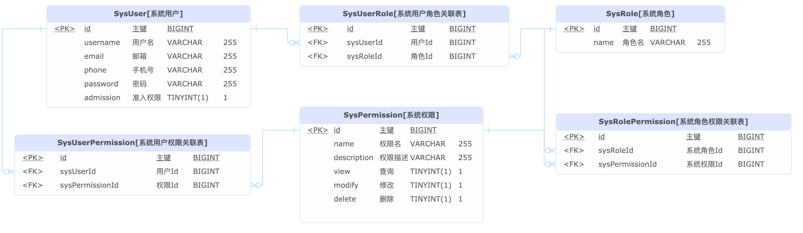

# 认证授权微服务

认证授权功能基于 Sa-Token 实现

## 实现方式

[在WebFlux中注册过滤器](https://sa-token.cc/doc.html#/up/global-filter)

在 Gateway 微服务增加认证授权限制。网关通过 HTTP 调用 auth 的 internal API（不是 Dubbo，也不是 gRPC）。

## TODO

根据业务需求来实现类及其功能

增加一些个性化接口

- [X]  踢人下线 kickOut
- [X]  按用户 id 查询角色：`GET /api/v1/internal/users/{id}/roles`
- [X]  按用户 id 查询权限：`GET /api/v1/internal/users/{id}/permissions`
- [X]  查询具有某角色的所有用户 SysUserService:listUsersByRoleId
- [X]  查询具有某权限的所有用户 SysUserService:listUsersByPermId
- [X]  查询具有某权限的所有用户，包括基于角色间接拥有权限的用户 SysUserService:listUsersWithRoleByPermId
- [ ]  用户注册，校验用户名必须唯一
- [X]  password加密后数据插入MySQL中数据不一致：重复调用加密算法，已解决
- [ ]  SysPermission，view modify delete 评估弃用，权限包含在name中
- [ ]  理清楚方法与类之间的关系

## 环境依赖

启动该应用前需先启动 mysql 和鉴权 redis

> **没有 Nacos，也没有 Dubbo**。网关用 HTTP 调用本服务的 internal API。
> local/prod 的 `auth.base-url` 为 `http://magic-auth:8999`，dev 为 `http://localhost:8999`。
> 见 [ADR-0008](../docs/adr/0008-remove-nacos.md)、[ADR-0009](../docs/adr/0009-remove-dubbo-http-openapi.md)。

## 概念设计

数据库设计

## 认证和授权

`AuthController`包括用户注册register、登陆login、登出logout功能。其他常规服务如下表：

| 控制器                | 说明         | 增 | 删 | 改 | 查 |
| --------------------- | ------------ | -- | -- | -- | -- |
| SysPermController     | 权限         | ✅ | ✅ | ✅ | ✅ |
| SysRoleController     | 角色         | ✅ | ✅ | ✅ | ✅ |
| SysRolePermController | 角色权限关联 | ✅ | ✅ | ✅ | ✅ |
| SysUserController     | 用户         | ✅ | ✅ | ✅ | ✅ |
| SysUserPermController | 用户权限关联 | ✅ | ✅ | ✅ | ✅ |
| SysUserRoleController | 用户角色关联 | ✅ | ✅ | ✅ | ✅ |

## 对内 HTTP

登录完成后，网关持有 Sa-Token 会话，每个请求同步调用下面两个接口（不经过网关路由）：

| 方法 | 路径 | 功能 |
|---|---|---|
| GET | `/api/v1/internal/users/{id}/permissions` | 用户直接权限 |
| GET | `/api/v1/internal/users/{id}/roles` | 用户角色 |

契约：`contracts/openapi/auth-internal.v1.yaml`。含角色间接权限的合并查询本轮不单独暴露。

## 参考

