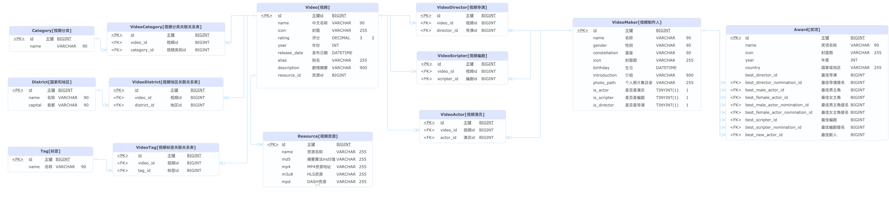

# 视频点播核心微服务

核心微服务，视频资源相关的影视剧、地区、演员、编剧、制片人、评分等常规操作。

## TODO
- [ ] Redis分布式缓存，通过SpringCache实现资源自动缓存

## 环境依赖

- MySQL数据库，数据库名：magic-video
- Redis（业务缓存）

> **没有 Nacos，也没有 Dubbo**。`has` 通过 HTTP 调用 core 的 internal 资源接口
> （`core.base-url`，local/prod 为 `http://magic-core:9001`）。
> 见 [ADR-0008](../docs/adr/0008-remove-nacos.md)、[ADR-0009](../docs/adr/0009-remove-dubbo-http-openapi.md)。

## 概念设计

数据库设计

## 对内 HTTP

播放源不走公网 CRUD。`has` 调用：

| 方法 | 路径 | 功能 |
|---|---|---|
| POST | `/api/v1/internal/resources` | 按 videoId 写入 mp4 / hls / dash |
| GET | `/api/v1/internal/resources/{id}` | 读回。`md5` 不落库，响应为 null |

契约：`contracts/openapi/core-internal.v1.yaml`。

