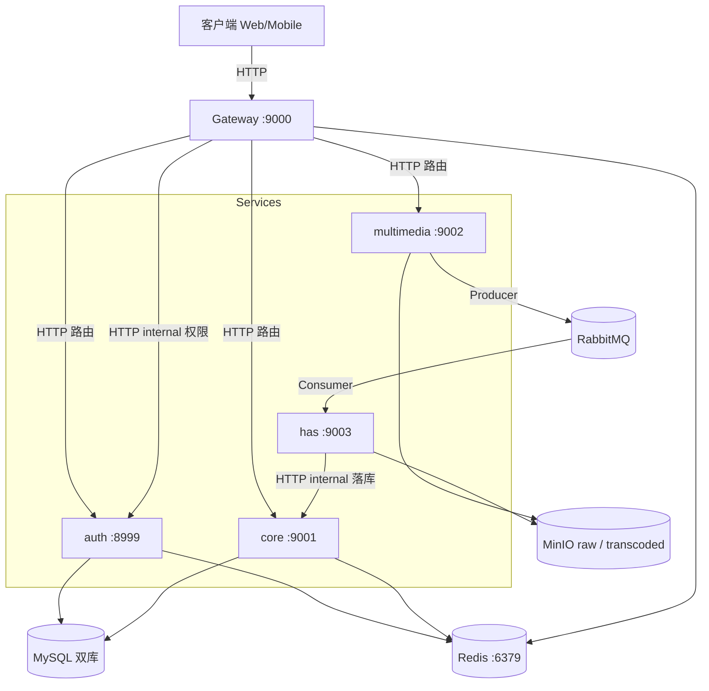
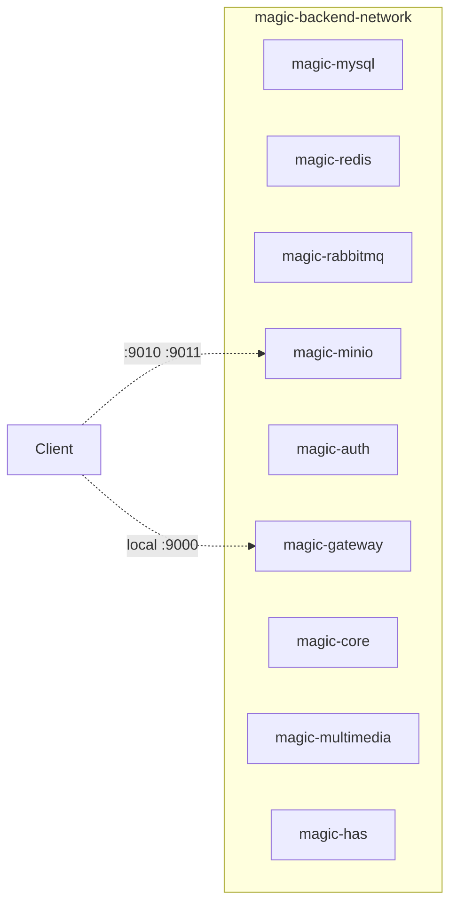

# 02 · 架构

> 本文档描述当前代码与编排，不是下一阶段的理想形态。
> 差距见 [`09-tech-debt.md`](09-tech-debt.md)。本轮决策见 ADR-0009、0010、0011。

## 服务清单

| 服务 | HTTP 端口 | 角色 | 状态 | 入口 |
|---|---|---|---|---|
| `auth` | 8999 | 用户、角色、权限；对内提供权限查询 | 无状态 | [auth/](../auth) |
| `gateway` | 9000 | Spring Cloud Gateway + Sa-Token | 无状态 | [gateway/](../gateway) |
| `core` | 9001 | 影视信息 CRUD；对内读写 `video_source` | 无状态 | [core/](../core) |
| `multimedia` | 9002 | 上传到 MinIO，投递转码消息 | 无状态 | [multimedia/](../multimedia) |
| `has` | 9003 | ffmpeg 转 HLS/DASH，HTTP 回写 core | 有状态（本地转码临时文件） | [has/](../has) |
| `mysql` | 3306 | `auth` 库 + 视频库（同一实例） | 有状态 | — |
| `redis` | 6379 | Sa-Token 与 core 缓存，一个实例 | 有状态 | — |
| `rabbitmq` | 5672 | multimedia → has | 有状态 | — |
| `minio` | 9000 / 9001 | bucket `raw`、`transcoded` | 有状态 | — |

没有注册中心，也没有 Dubbo。地址写在各服务 `bootstrap-{profile}.yaml`。见 [ADR-0008](adr/0008-remove-nacos.md) 与 [ADR-0009](adr/0009-remove-dubbo-http-openapi.md)。

共享库是 [`platform/platform-web`](../platform/platform-web)（`Result`、异常、分页、Jackson）。服务间契约在 [`contracts/`](../contracts)（OpenAPI + AsyncAPI），不是 Maven 模块。`common/` 已删除。

## 调用关系

实线是同步 HTTP 或基础设施访问。异步只有 RabbitMQ 一条。

## 调用矩阵

| 调用方 | 被调方 | 协议 | 触发场景 | 地址 |
|---|---|---|---|---|
| 客户端 | gateway | HTTP | 全部对外流量 | 宿主机 `:9000`（prod 经 Nginx `:8081`） |
| gateway | auth / core / multimedia | HTTP | 登录与业务路由 | `http://<host>:<port>`，转发时补 `/api/v1` |
| gateway | auth | HTTP internal | 每个已登录请求查角色/权限 | `GET /api/v1/internal/users/{id}/permissions` 与 `/roles` |
| multimedia | has | RabbitMQ | 上传成功后转码 | 交换机 / 队列见 `contracts/asyncapi/transcode.v1.yaml` |
| has | core | HTTP internal | 转码成功后写 `video_source` | `POST /api/v1/internal/resources` |
| multimedia / has | MinIO | S3 SDK | 原片与 HLS/DASH | `http://magic-minio:9000`，bucket `raw`、`transcoded` |

internal 路径不在网关路由表里。local 与 prod 不把 8999/9001 映射到宿主机，靠容器网络隔离。

### 内部 base URL

| 配置 | local | dev | prod |
|---|---|---|---|
| `auth.base-url` | `http://magic-auth:8999` | `http://localhost:8999` | `http://magic-auth:8999` |
| `core.base-url` | `http://magic-core:9001` | `http://magic-core:9001` | `http://magic-core:9001` |

dev 的 has 仍指向容器主机名 `magic-core`。在 IDE 里跑 has 时，这个名字必须解析到本机，或改成 `http://localhost:9001`。

## 部署形态（docker-compose 单机）

- local：对外是 gateway `9000` 与 MinIO `9010/9011`。其余只在容器网络内。
- dev：中间件映射到宿主机（MySQL `3306`、Redis `6379`、RabbitMQ `5672/15672`、MinIO `9010/9011`）。微服务在 IDE 里听 8999–9003。dev compose 另有 `magic-loki-minio`（`9030/9031`），只存日志，不存媒资。
- prod（`mini-local.yaml`）：Nginx `8081`，以及同一个 MinIO `9010/9011`。五个业务服务都在编排里。
- 启动顺序由 `depends_on` 表达：MySQL / Redis / RabbitMQ → auth → gateway → core → multimedia / has。没有注册中心等待。

Redis 只有 `magic-redis`。Sa-Token 用前缀 `sa-token:`，core 缓存用前缀 `core:`，都在 database 0。见 [ADR-0011](adr/0011-single-minio-redis.md)。

## 关键约束

1. **Sa-Token 与 core 缓存共用一个 Redis**。Redis 不可用时，登录态和缓存一起失效。
2. **单实例**。多副本时用 K8s Service DNS 注入 base URL，不恢复 Nacos 或 Dubbo。
3. **HAS 转码占用本地磁盘**。临时目录在转码过程中存在；对象存进 MinIO 后的清理仍见技术债 P1-5。
4. **网关是唯一业务入口**。internal API 不经过网关。

## 本轮非目标

下列事项只记录在设计规格第 8 节，本轮不实现：

- 可运行的 K8s 清单（现有草稿在 [`docs/archive/k8s/`](archive/k8s/README.md)，不能 `kubectl apply`）
- 服务网格、mTLS、用网格替换 internal 的网络隔离
- 用 Ingress / Gateway API 替换 Spring Cloud Gateway
- gRPC
- 合并五个业务服务，或合并 MySQL 两个库
- Flyway / Testcontainers 全套
- 把 Nacos 或 Dubbo 加回来

当需要多副本或跨机容灾时，再按设计规格第 8 节单独立项，而不是在本轮编排上叠注册中心。
