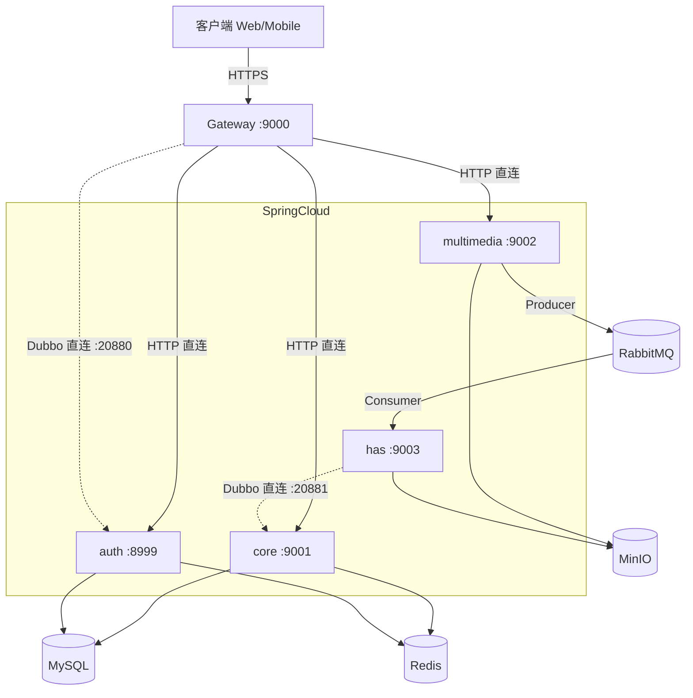
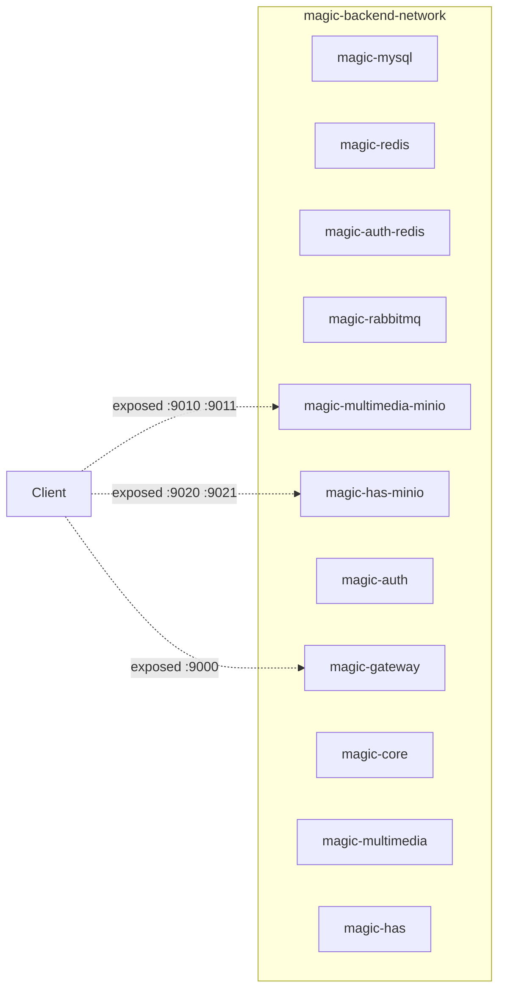

# 02 · 架构

> 本文档描述"当前架构"——即代码实际反映的结构，不是"理想形态"。
> 理想形态与现状的差距见 `09-tech-debt.md`。

## 服务清单

| 服务 | 端口 | 角色 | 状态 | 入口 |
|---|---|---|---|---|
| `auth` | 8999 | 用户鉴权、权限、角色 | 无状态 | [auth/](../auth) |
| `gateway` | 9000 | 入口网关 (Spring Cloud Gateway, WebFlux) | 无状态 | [gateway/](../gateway) |
| `core` | 9001 | 视频/合集/季/演员/导演 等 CRUD | 无状态 | [core/](../core) |
| `multimedia` | 9002 | 视频/图片上传到对象存储、发 MQ 消息 | 无状态 | [multimedia/](../multimedia) |
| `has` | 9003 | 视频转码 (ffmpeg HLS/DASH) | **有状态**（本地落 HLS 文件） | [has/](../has) |
| `mysql` | 3306 | 业务库 | 有状态 | — |
| `redis` | 6379 / 6389 | 缓存 + Sa-Token session | 有状态 | — |
| `rabbitmq` | 5672 | 异步消息（转码任务） | 有状态 | — |
| `minio` | 9000 / 9001 | 对象存储 | 有状态 | — |

> **没有注册中心。** 服务间地址直接写在各服务的 `bootstrap-{profile}.yaml` 里，
> 依据见 [ADR-0008](adr/0008-remove-nacos.md)。

## 调用关系

> **图例**：实线 = 同步调用，虚线 = Dubbo RPC 或异步。
> 所有地址均为**显式配置**（各服务 `bootstrap-{profile}.yaml`），无服务发现组件。

## 调用矩阵

| 调用方 | 被调方 | 协议 | 触发场景 | 备注 |
|---|---|---|---|---|
| 客户端 → gateway | gateway | HTTPS/HTTP | 所有外部流量 | gateway 是唯一对外入口；**请求路径不带版本前缀**，网关转发时补 `/api/v1` |
| gateway → auth | auth | HTTP 直连 | 登录、登出、查询用户 | `http://<auth-host>:8999` |
| gateway → core | core | HTTP 直连 | 视频/合集 CRUD | `http://<core-host>:9001` |
| gateway → multimedia | multimedia | HTTP 直连 | 图片/视频上传 | `http://<multimedia-host>:9002` |
| gateway → auth (Dubbo) | auth | Dubbo RPC 直连 | **每次请求鉴权查权限/角色** | `dubbo://<auth-host>:20880`，无注册中心 |
| has → core (Dubbo) | core | Dubbo RPC 直连 | 转码完成后落资源 | `dubbo://<core-host>:20881` |
| multimedia → has (异步) | has | RabbitMQ | 上传成功后投递转码消息 | fanout 广播；失败进死信队列 |
| has → MinIO | MinIO | SDK | 转码产物上传 | |

### Dubbo 端口分配

| 服务 | Dubbo 端口 | 角色 |
|---|---|---|
| `auth` | 20880 | `UserPermService` 提供方 |
| `core` | 20881 | `ResourceService` 提供方 |
| `gateway` | 20882 | 消费方 |
| `has` | 20883 | 消费方 |

> 协议端口**固定**，不使用 `-1`（随机端口）：直连消费方无法寻址随机端口。

## 部署形态（docker-compose 单机）

**关键约束**：
- 仅 `gateway:9000`、`minio:9010/9011`、`minio:9020/9021` 暴露到宿主机，其他服务**只走容器内网**
- 启动顺序：`mysql/redis/rabbitmq/minio` → `auth` → `gateway` → `core` → `multimedia` / `has`（通过 `depends_on.condition: service_healthy` 表达）
- **没有 Nacos**，因此不存在「等待注册中心就绪」这一步

## 关键技术约束

1. **HAS 模块含 worker DSL**：ffmpeg 进程从 `/home/magic/...` 路径读写，依赖 `user.home` 系统属性（详见 `09-tech-debt.md` P1-2）
2. **HAS 在 docker 中需挂载持久卷**：HLS 文件需要保留，否则 Pod 重建 → 媒体丢失
3. **Sa-Token session 在 Redis**：Redis 挂掉 = 所有用户被踢出
4. **单实例部署**：服务发现被移除的前提是每个服务只有 1 个实例；一旦需要多副本，
   必须重新引入服务发现（届时建议用 K8s 原生能力，**不要再把 Nacos 请回来**）

## 不做什么（明确边界）

- ❌ **不做 K8s 集群部署**（单机 docker-compose 足够）
- ❌ **不做服务网格**（Istio/Linkerd 没必要）
- ❌ **不做集群限流 / 熔断**（单机 Redis + Sentinel 足够）
- ❌ **不做分布式追踪**（单机日志足够排障）
- ❌ **不做 Service Mesh mTLS**（网关 TLS termination 即可）
- ❌ **不引入注册中心 / 配置中心中间件**（见 [ADR-0008](adr/0008-remove-nacos.md)）

> 这些"不做"是当前阶段的决策。当业务复杂度上升（QPS > 1000、单点扛不住、跨机房容灾）时需要重新评估。
