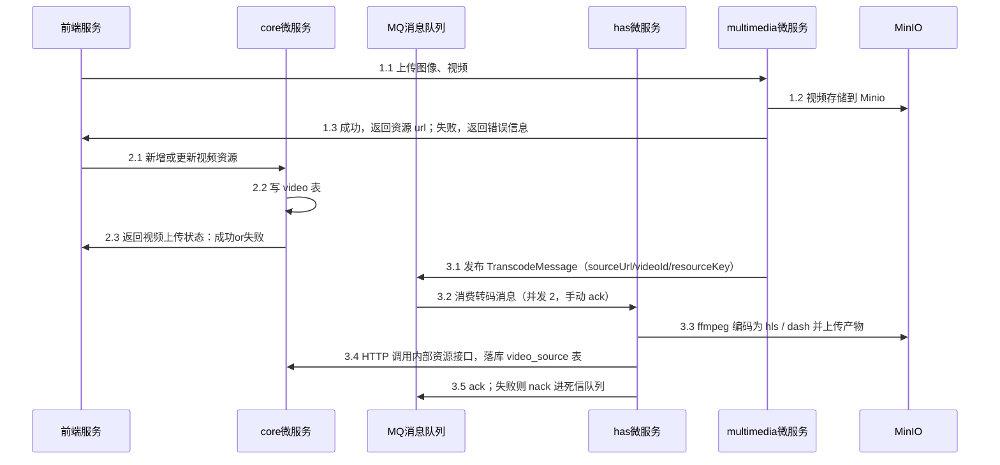

# Http Adaptive Streaming视频转码

将视频转码为dash和hls格式

## 更新日志

2024-10-28 更新文档目录结构

## Todo

- [ ]  ffmpeg 脚本优化
- [X]  ffmpeg 转码 dash
- [X]  ffmpeg 转码 hls
- [X]  mysql 依赖是需要的吗？不需要的话删除（确认不需要，本模块无 entity/Mapper，未引入 MyBatis）
- [ ]  转码任务表 + 状态机 + 进度查询接口（当前无状态查询，见 ADR-0006）

## 环境依赖

- RabbitMQ：消费 `video.resource` 队列（手动 ack + 死信队列）
- MinIO：存放 HLS / DASH 转码产物
- core：通过内部 HTTP 落库（`core.base-url`，默认 `http://magic-core:9001`）

> **没有 Nacos**：本项目已彻底移除注册中心与配置中心，地址写在 `bootstrap-{profile}.yaml` 里。
> 详见 [ADR-0008](../docs/adr/0008-remove-nacos.md)。

## 开发文档

**视频在服务端编码为 hls 和 dash 格式**

> 📌 上面的时序是 **2026-11-08 落地后的实际形态**（此前由 core 发消息、消息体是
> `java.net.URL`、落库表叫 `videoResource`，均已修正）。
> 决策与取舍见 [ADR-0006](../docs/adr/0006-async-transcoding.md)、
> [ADR-0007](../docs/adr/0007-rabbitmq-consumer-ack.md)。

待思考的问题：

1. 大视频上传需要**分片上传**，需要在前端分片，如何保证后端接收到完整的分片？
2. 视频转码需要**进度**，如何保证转码进度可以实时反馈给前端？
   → **仍未解决**：当前没有任务表与状态机，只能看 `has` 日志。
   落地任务表见 [ADR-0006](../docs/adr/0006-async-transcoding.md) 的「负面 / 已知缺口」。
3. 视频转码需要**异步**，转码完成后是否需要通知前端，如何实现？
   → **已部分解决**：转码已异步化（MQ 队列 + 有界并发），但**完成通知尚未实现**。
4. 后端接收到视频资源后，需要合并吗？
5. 视频存储到 minio 时会自动分片，ffmpeg 编码 dash 和 hls 需完整视频块？服务端存储合并视频，ffmpeg 分片后传输到 minio，然后在服务端删除原视频。

## 参考

